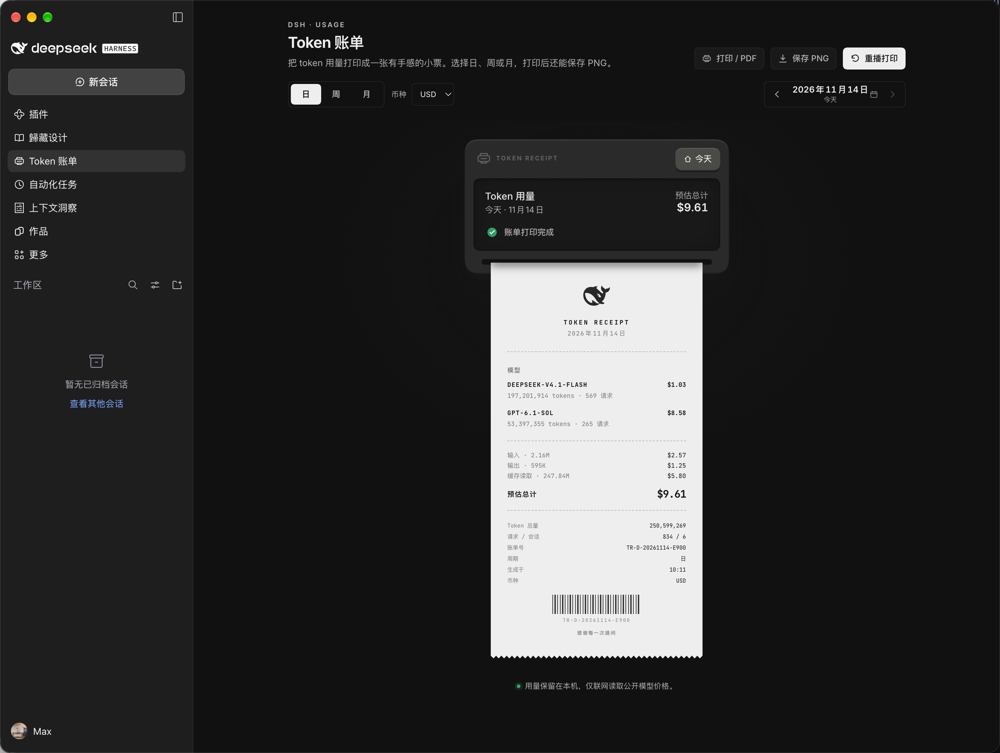
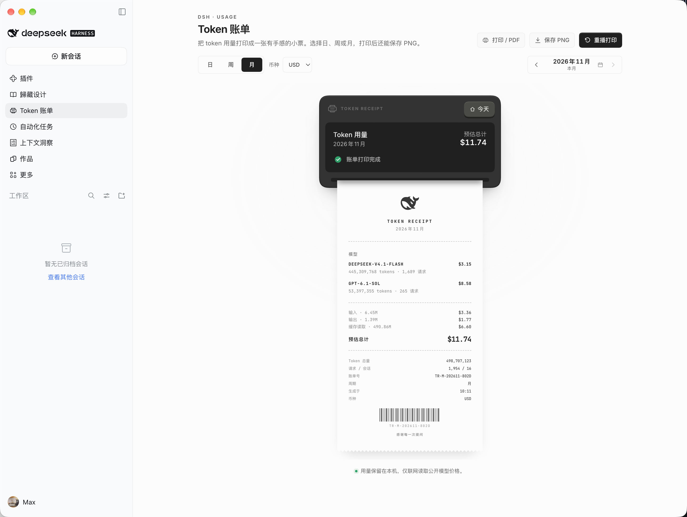

<div align="center">
  
  <h1>トークン明細</h1>
  <p>DeepSeek Harness の日・週・月・直近30日・直近90日・全期間のトークン使用量と推定モデル料金を、手触りのあるレシートとして印刷し、画像のコピーや PNG 保存ができます。</p>
  <p>
    <a href="https://www.npmjs.com/package/dsh-token-receipt"></a>
    <a href="LICENSE"></a>
    <a href="https://github.com/maxlee/dsh-token-receipt/actions/workflows/ci.yml"></a>
    =0.2.2-rc.3" />
  </p>
  <p>
    <a href="README.md">English</a> · <a href="README.zh.md">简体中文</a> · <strong>日本語</strong>
  </p>
</div>

| ダーク · 日次明細 | ライト · 月次明細 |
| :---: | :---: |
|  |  |

## 主な機能

トークン明細は、DeepSeek Harness のローカル使用記録をレシート形式で集計・出力するプラグインです。

- **期間の切り替え。** **日**・**週**・**月**・**直近30日**・**直近90日**・**全期間** の明細を切り替えられ、日・週・月ではパネル内で過去の日付や今日へ移動できます。期間を切り替えるたびに紙送りアニメーションが再生されます。
- **モデル別の推定料金。** [models.dev](https://models.dev) の公開レートに基づき、入力・出力・キャッシュ読込・キャッシュ書込ごとの内訳を表示します。
- **複数通貨への対応。** 表示言語に応じた自動選択のほか、`USD`・`CNY`・`JPY` を手動で切り替えられます。
- **レシートプリンター演出。** 期間の切り替えに合わせてステップ紙送り、切り口、バーコードを再生し、OS の視差効果を減らす設定にも自動で追従します。
- **高解像度エクスポートと共有。** **画像をコピー** で 3 倍解像度の PNG をクリップボードへ直接コピーしてすぐ貼り付け・共有できるほか、**PNG を保存** で画像ファイルとしてダウンロードできます。
- **多言語とテーマ対応。** 日本語・English・简体中文のインターフェースと、ライト・ダーク両テーマに対応しています。

> [!NOTE]
> 表示される金額は [models.dev](https://models.dev) の公開カタログレートから算出した参考推定値であり、プロバイダーからの実際の請求額ではありません。セッションとトークン使用量のデータはすべて端末内に保持され、オンライン通信は公開料金レートの取得にのみ使用されます。

## インストール

### npm からインストール

DeepSeek Harness で **Plugins** を開き、**Add plugin** をクリックして以下を入力します。

```text
dsh-token-receipt
```

または `plugin_manager` ツールでインストールします。

```json
{
	"action": "install_bundle",
	"target": "dsh-token-receipt"
}
```

### ローカルリポジトリからインストール

ローカルのチェックアウト先の絶対パスを `plugin_manager` に指定します。

```json
{
	"action": "install_bundle",
	"target": "/absolute/path/to/dsh-token-receipt"
}
```

DeepSeek Harness に `restart-required` と表示された場合は、アプリを一度再起動してください。

## 使い方

DeepSeek Harness の言語設定で **日本語** を選択すると、日本語インターフェースに切り替わります。

1. 左サイドバーから **トークン明細** を開きます。
2. **日**・**週**・**月**・**直近30日**・**直近90日**・**全期間** から期間を選びます（日・週・月では日付コントロールで過去の日付や今日へ移動できます）。期間を切り替えると紙送りアニメーションが再生されます。
3. **通貨** メニューから `USD`・`CNY`・`JPY` または **言語に合わせる** を選びます。
4. **画像をコピー** で 3 倍解像度の PNG をクリップボードに直接コピーしてそのまま貼り付け・共有でき、**PNG を保存** で画像をダウンロードできます。**印刷を再生** をクリックすると紙送りアニメーションをもう一度再生できます。

## 動作環境と開発

必要な実行環境は以下の通りです。

- DeepSeek Harness `>=0.2.2-rc.3 <0.3.0`
- Node.js `^22.19.0 || >=24.0.0`

ローカル環境で構文チェックとテストを実行するには、以下のコマンドを使用します。

```bash
npm run check && npm test
```

## ライセンス

[MIT License](LICENSE) のもとで公開されています。

レシートプリンターのインタラクションは [dqnamo の Receipt Printer](https://www.dqnamo.com/experiments/receipt-printer) に着想を得ており、料金解決ロジックの一部は [dsh-context](https://github.com/bowenliang123/dsh-context) をもとに改変しています。Apache-2.0 および SIL Open Font License 1.1 のライセンス表記については [THIRD_PARTY_NOTICES.md](THIRD_PARTY_NOTICES.md) を参照してください。
