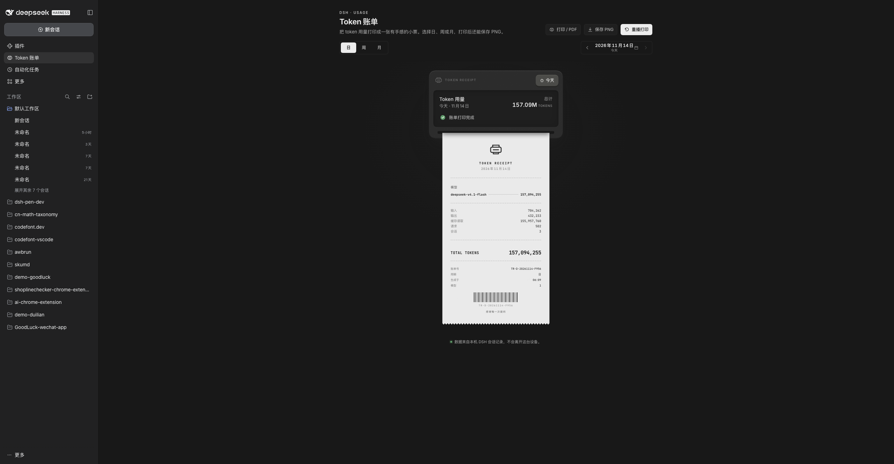
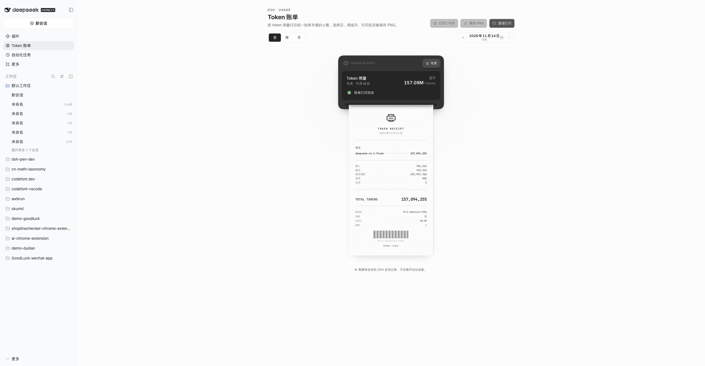
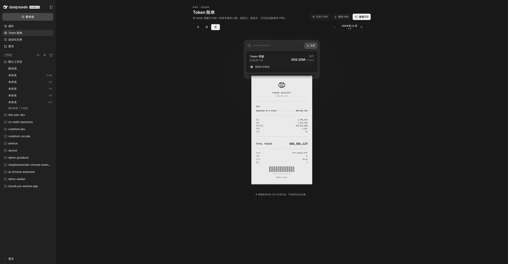

# Token Receipt for DeepSeek Harness

[](https://www.npmjs.com/package/@maxlee/dsh-token-receipt)
[](LICENSE)

A DeepSeek Harness plugin that prints your daily, weekly, or monthly token
usage as a tactile receipt — complete with a stepped paper feed, a torn edge,
and a barcode. Save the finished receipt as a PNG or send it through the
system print dialog.

[中文说明](README.zh.md)



## Features

- **Daily / weekly / monthly bills** — switch periods and move backwards or
  forwards without leaving the page.
- **Tactile receipt printer animation** — processing, stepped paper feed, and
  a completion state, adapted from the dqnamo Receipt Printer study.
- **Save as PNG** — exports the actual receipt card at 3× resolution.
- **Print / PDF** — uses the browser's system print dialog with a print-only
  stylesheet, so only the receipt is printed.
- **Local by design** — reads recorded token usage from local DSH session logs;
  no data leaves the machine.
- **Light and dark themes**, Chinese and English, and reduced-motion support.



## Install

### From npm (recommended)

Open **Plugins → Add plugin** in DeepSeek Harness and enter:

```text
@maxlee/dsh-token-receipt
```

Or use the DSH `plugin_manager` tool with an installation spec:

```json
{
  "action": "install_bundle",
  "target": "@maxlee/dsh-token-receipt@1.0.0"
}
```

After installation, open **Token 账单 / Token receipt** from the left sidebar.
If DSH reports `restart-required`, restart the app once.

### From a local checkout

```text
plugin_manager install_bundle
target: /absolute/path/to/dsh-token-receipt
```

## Usage

1. Open **Token 账单 / Token receipt** in the left sidebar.
2. Pick **日 / 周 / 月** (day / week / month), or use the date picker.
3. The first visit plays the printer animation; use **重播打印 / Replay print**
   to replay it.
4. Use **保存 PNG / Save PNG** to download a high-resolution receipt image.
5. Use **打印 / PDF / Print / PDF** for the system print dialog.



## Data and privacy

The plugin reads token usage from local DSH session records through the DSH
host APIs. It does not send session data anywhere. Only messages with a
recorded `usage` value are included; old messages without usage metadata are
not estimated. Monetary cost is not calculated.

## Compatibility

- DeepSeek Harness `>=0.2.2-rc.3 <0.3.0`
- Node.js `^22.19.0 || >=24.0.0`

The bundle contains both a Host half (`index.js`) and a Client half
(`client.js`), plus locale resources, a detail illustration, and an icon.

## Development

```bash
node --check index.js
node --check client.js
npm pack --dry-run
```

The plugin has no runtime npm dependencies. Fonts are embedded in the client
bundle: Inter and JetBrains Mono, both under the SIL Open Font License 1.1.
See [docs/FONTS.md](docs/FONTS.md).

## Credits

The receipt-printer interaction is inspired by
[dqnamo's Receipt Printer experiment](https://www.dqnamo.com/experiments/receipt-printer).
This repository is an independent implementation; the bundled textures are
original procedural SVGs.

## License

MIT — see [LICENSE](LICENSE).
