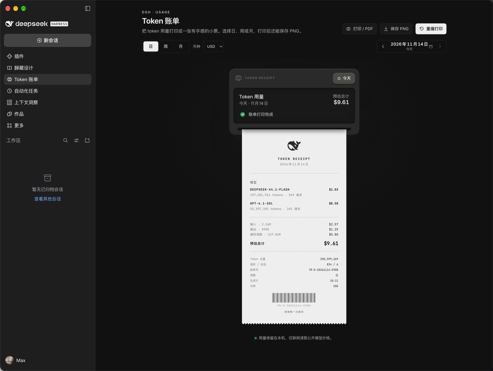
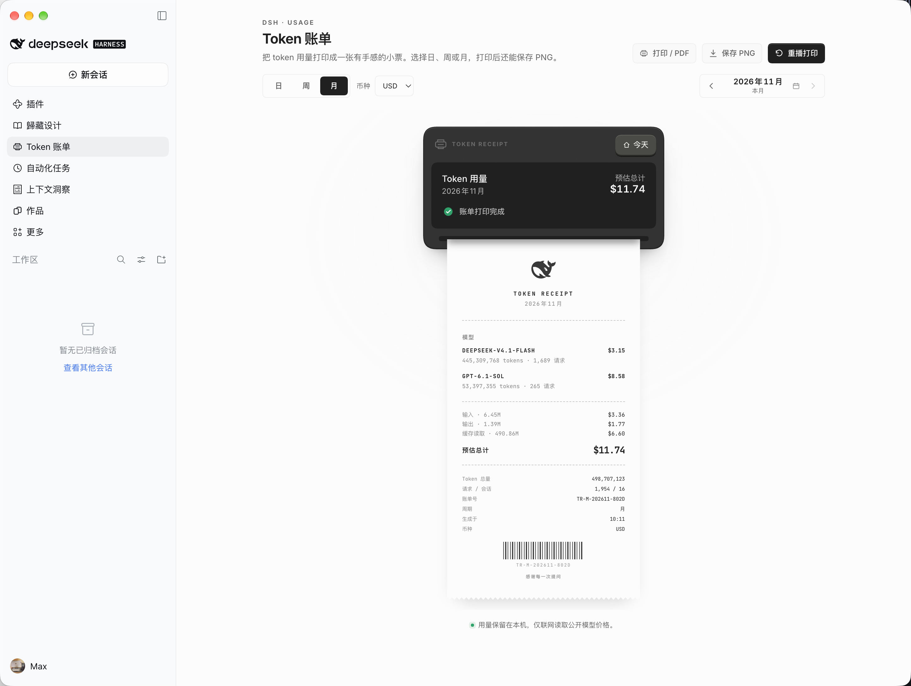

<div align="center">
  
  <h1>Token 账单</h1>
  <p>将 DeepSeek Harness 日、周、月、近 30 天、近 90 天与全部周期的 Token 用量及预估模型费用打印成一张有质感的小票，支持复制图片与保存 PNG。</p>
  <p>
    <a href="https://www.npmjs.com/package/dsh-token-receipt"></a>
    <a href="LICENSE"></a>
    <a href="https://github.com/maxlee/dsh-token-receipt/actions/workflows/ci.yml"></a>
    =0.2.2-rc.3" />
  </p>
  <p>
    <a href="README.md">English</a> · <strong>简体中文</strong> · <a href="README.ja.md">日本語</a>
  </p>
</div>

| 深色 · 每日账单 | 浅色 · 每月账单 |
| :---: | :---: |
|  |  |

## 功能特性

Token 账单将本地 DeepSeek Harness 用量记录整理为可打印的小票：

- **周期切换。** 查看 **日**、**周**、**月**、**近 30 天**、**近 90 天** 与 **全部** 账单；在日、周、月视图下可在同一面板内翻阅历史日期或回到今天，切换周期时自动播放送纸打印动画。
- **预估模型费用。** 基于 [models.dev](https://models.dev) 公开价格，按模型及输入、输出、缓存读取、缓存写入分别展示费用明细。
- **多币种显示。** 默认币种自动跟随界面语言，也可随时手动切换 `USD`、`CNY` 与 `JPY`。
- **小票打印动效。** 呈现阶梯送纸、纸张撕边与条形码细节，每次切换周期都会自动播放，并自动适配系统的减弱动态效果设置。
- **高清导出与分享。** 点击 **复制图片** 可将 3 倍分辨率 PNG 直接复制到剪贴板以便即刻粘贴分享，也可点击 **保存 PNG** 下载本地图片。
- **多语言与明暗主题。** 支持简体中文、English、日本語界面，适配浅色与深色主题。

> [!NOTE]
> 小票金额基于 [models.dev](https://models.dev) 公开目录价格计算，仅作参考估算，不等同于供应商实付账单。所有会话与 Token 用量数据均保留在本地设备，联网仅用于读取公开价格目录。

## 安装

### 从 npm 安装

在 DeepSeek Harness 中打开 **Plugins**，点击 **Add plugin**，输入：

```text
dsh-token-receipt
```

也可以使用 `plugin_manager` 工具安装：

```json
{
	"action": "install_bundle",
	"target": "dsh-token-receipt"
}
```

### 从本地仓库安装

将本地仓库绝对路径传入 `plugin_manager`：

```json
{
	"action": "install_bundle",
	"target": "/absolute/path/to/dsh-token-receipt"
}
```

如果 DeepSeek Harness 提示 `restart-required`，重启一次应用即可启用插件。

### 在 DSH Desktop 上更新

如果更新包含浏览器端界面（`client.js`），请完全退出 DeepSeek Harness 后重新打开。仅关闭插件页面、禁用/启用插件或关闭窗口都不够：DSH Desktop 只会在应用窗口启动时加载浏览器端的插件 bundle。不需要卸载重装。1.1.1 及以后版本检测到「已安装版本比当前页面新」时，会显示带 **刷新界面** 按钮的提示。

## 使用

1. 在左侧边栏打开 **Token 账单**。
2. 选择 **日**、**周**、**月**、**近 30 天**、**近 90 天** 或 **全部**（在日、周、月视图下可通过日期控件翻阅历史日期或回到今天）；切换周期时会自动播放送纸打印动画。
3. 在 **币种** 菜单中选择 `USD`、`CNY`、`JPY` 或 **跟随语言**。
4. 点击 **复制图片** 将 3 倍分辨率 PNG 小票直接复制到剪贴板以便粘贴分享，点击 **保存 PNG** 下载本地图片，或点击 **重播打印** 再次播放送纸动画。

## 兼容性与开发

运行环境要求：

- DeepSeek Harness `>=0.2.2-rc.3 <0.3.0`
- Node.js `^22.19.0 || >=24.0.0`

在本地仓库中运行语法检查与单元测试：

```bash
npm run check && npm test
```

## 许可证

基于 [MIT License](LICENSE) 开源。

小票打印机交互灵感来自 [dqnamo 的 Receipt Printer](https://www.dqnamo.com/experiments/receipt-printer)，价格解析部分改编自 [dsh-context](https://github.com/bowenliang123/dsh-context)。Apache-2.0 与 SIL Open Font License 1.1 相关声明见 [THIRD_PARTY_NOTICES.md](THIRD_PARTY_NOTICES.md)。
